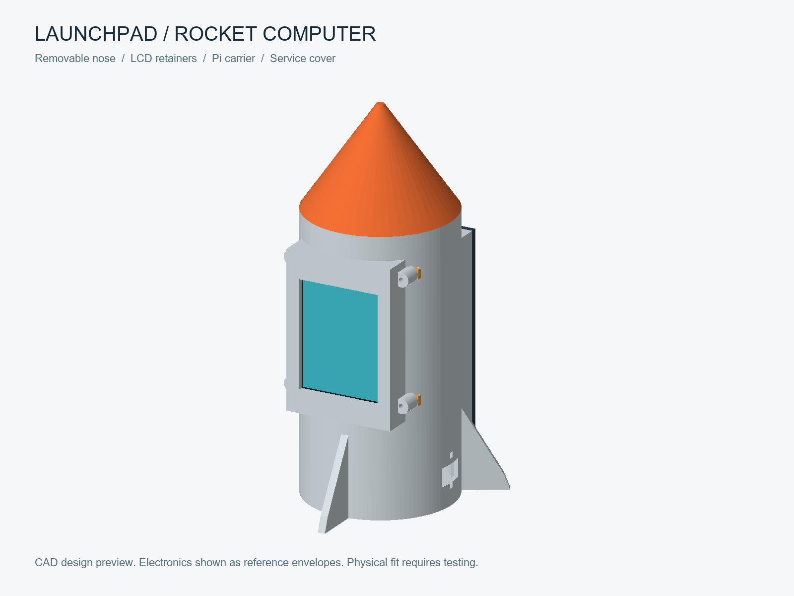
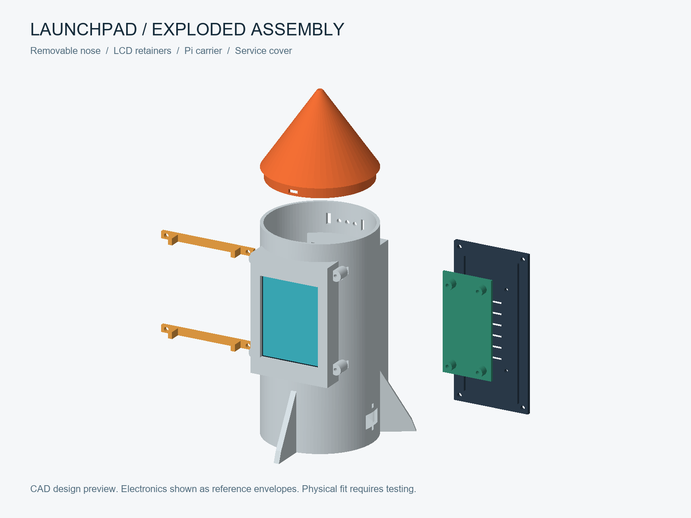
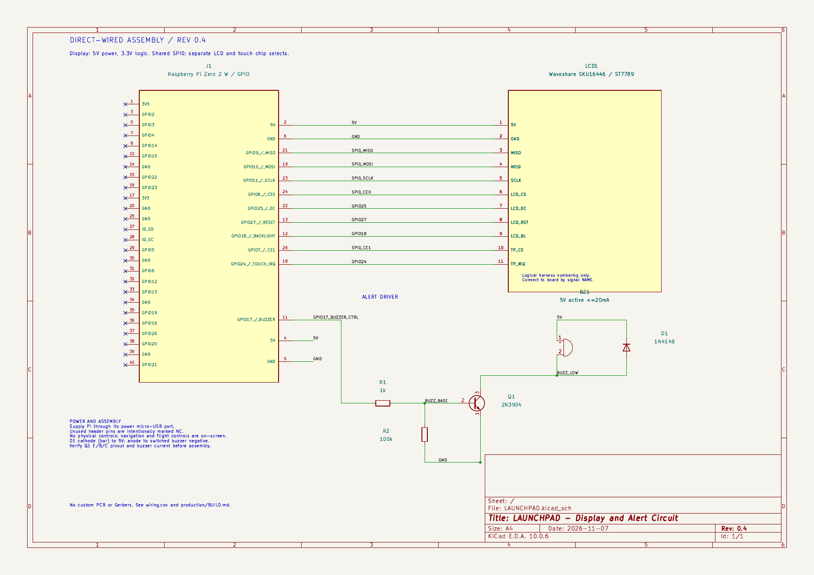

# LAUNCHPAD

A rocket-shaped Raspberry Pi mission-control computer for Hack Club Half Life. A small touchscreen follows the ISS, counts down rocket launches, explains missions, shows observing weather, and lets you fly a tiny simulated rocket.

**Status: unbuilt prototype design.** The code, KiCad schematic and FreeCAD exports are included. This is not a claim of tested hardware, verified print fit or a completed physical build. See [validation](production/VALIDATION.md) for checks performed and remaining work.







## Five modes

1. **ISS Watch:** live coordinates, locally predicted passes above 10 degrees, approximate visibility at peak, optional buzzer alert.
2. **Launch Clock:** upcoming launches with NET (no-earlier-than) times and schedule status. Launch times can change.
3. **Mission Brief:** payload, rocket, mission description and launch pad.
4. **Skywatch:** temperature, cloud cover, humidity, wind, sunrise and sunset for a manually configured location.
5. **Flight Sim:** offline educational rocket game. On-screen throttle, steering, ignition, one staging event and reset. Simplified gravity/drag physics; no real rocket control.

ISS video is a deferred stretch goal, not part of the working five-mode scope. No video playback support is claimed.

## Try it now

```sh
python firmware/server.py --demo
```

Open **http://127.0.0.1:8080**. Demo data is visibly labelled and fictional. The standard-library server runs on Windows, macOS or Linux. Install the requirements for live pass prediction and Pi hardware support; configure location before using weather/pass alerts.

## Hardware

- Raspberry Pi Zero 2 W, microSD, regulated 5V micro-USB power from the existing battery/buck after load verification.
- Waveshare **SKU16446, 2.8inch Resistive Touch LCD, ST7789 revision**, with XPT2046 touch. This replaces the initially unspecified 2.3-inch display. Confirm the controller with the seller; older HX8347D stock is not supported by the included native LCD client.
- Optional sound alerts: 5 V active buzzer <=20 mA, 2N3904, 1k and 100k resistors, 1N4148 diode.
- Breadboard/perfboard, headers, jumper wire, mounting screws/spacers, foam tape, PLA.

The [BOM](bom.csv) includes quantities, cost status, supplier links and source dates. Prices are not a checkout guarantee; printing and a delivery allowance are included as separate BOM lines. This all-new build exceeds the original Rs3144 budget. Do not order until checking the display revision and current costs.

## Files

```text
cad/         FreeCAD source, regeneration script, parameters, STL and STEP
pcb/         KiCad schematic source, netlist, PDF and wiring CSV; no fabricated PCB
production/  Build guide, service files, validation and sources
firmware/    Backend, native SPI touchscreen client, browser app and tests
images/      CAD and app previews; no fabricated build photographs
bom.csv      Parts, quantities, costs and links
README.md    This guide
```

Start with [BUILD.md](production/BUILD.md). Six printable parts include the barrel, removable slip-fit nose, rear service cover, Pi carrier and two screwed LCD-edge retainers. The body has a full screen pocket, flat rear mating flange, ventilation, sound holes, cable-tie passages and fins. A separate Pi carrier has 58 x23 mm mounting centres. The six printed parts are valid single solids with no mutual intersections; they also clear the manufacturer LCD STEP at the planned placement. Printed tolerances, active-area alignment and cable clearances still require physical tests.

## Sources and software

Case: FreeCAD 1.0, exported as `.FCStd`, `.STEP` and `.STL`, generated from the included parameter file and Python source. Electronics: KiCad 10 schematic and netlist, using standard symbols plus a logical display harness. Firmware: Python and browser JavaScript; no custom PCB required. Physical assembly has not been performed.

Sources: [Waveshare module documentation](https://www.waveshare.com/wiki/2.8inch_Resistive_Touch_LCD), [Skyfield](https://rhodesmill.org/skyfield/earth-satellites.html), [CelesTrak](https://celestrak.org/NORAD/elements/), [Where the ISS at?](https://wheretheiss.at/w/developer), [Launch Library 2](https://ll.thespacedevs.com/docs/), [Open-Meteo](https://open-meteo.com/en/docs). Full citations and limits are in [SOURCES.md](production/SOURCES.md). Respect each provider's current usage terms; cached data can be stale.

The public repository must not contain local config, coordinates, tokens, caches or touch calibration. Those files are ignored. No redistribution license has been selected by the owner; upstream symbols/dependencies retain their own licenses.

## Submission release 0.7 — 8 November 2026

The final minimum-cost BOM totals **Rs5640**, including Robu's Rs951 six-part print quote, a Rs250 delivery allowance and a Rs50 power-lead allowance. It counts the owner's existing 12V battery and LM2596 at zero purchase cost and omits the optional buzzer circuit and its breadboard (Rs102 saved). All five display modes remain available; physical sound alerts require fitting the optional circuit. The Pi Rs2079 amount is an earlier listing observation, not a current checkout guarantee. This is **not a verified Rs3500 build**. See [budget](production/BUDGET.md) and [print quote](production/PRINT-QUOTE.md).

ISS Watch lists predicted passes, peak directions and orbital-data age. The browser simulator offers 1/2.5/5 km targets, pause/resume, telemetry and saved fuel records. The portrait client supports the same targets with a simpler vertical model, release-to-repeat touch controls and pause/resume. Run `python firmware/preflight.py --hardware` on the Pi to check installation prerequisites without driving GPIO.

Final checks: **16 Python tests**, JavaScript simulation checks and netlist checks pass; KiCad ERC reports **0 errors and 0 warnings**. The six CAD solids and STEP/STL exports are included with fit coupons. Printing, battery power, LCD revision, touch and actual Pi operation remain untested. The battery stays external; the existing case does not have a verified battery/buck mounting design.

For the submission, use the repository URL and the source archive. [SUBMISSION.md](production/SUBMISSION.md) contains a concise project description and an accurate validation statement.
